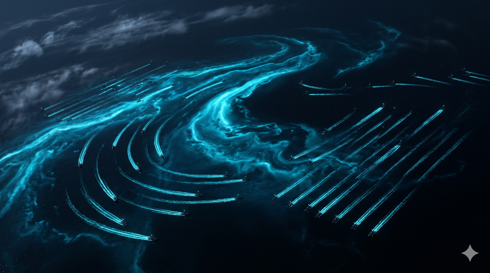

# PELAGIC // Ocean Gyre Digital Twin



PELAGIC is an immersive React and WebGL experience that visualizes ocean gyres, surface and subsurface microplastic concentration, and a simulated autonomous interceptor fleet. Explore three gyre profiles, inspect telemetry, and simulate a live collection sweep through a scroll-driven ocean interface.

**Repository:** [Pelagic-Ocean-Twin](https://github.com/Anish-21-12-2007/Pelagic-Ocean-Twin)

**Live deployment:** [https://anish-21-12-2007.github.io/Pelagic-Ocean-Twin/](https://anish-21-12-2007.github.io/Pelagic-Ocean-Twin/)

## Highlights

- Scroll-scrubbed 100vw × 100vh video stage with crossfades between surface, subsurface, and interceptor scenes
- GPU-instanced 3,200-particle ocean field with pointer-driven vortex motion and 3D camera parallax
- Interactive Great Pacific, Indian Ocean, and North Atlantic gyre profiles
- Hold-to-sweep microplastic collection simulation with live recovery, fuel, and sweep telemetry
- Configurable 1–24 unit autonomous drone fleet
- Custom GLSL ocean fallback while the video assets load
- Five responsive, scroll-choreographed editorial chapters

## Technology

- React 19 and TypeScript
- Vite
- Tailwind CSS
- Three.js
- React Three Fiber and Drei
- GSAP ScrollTrigger
- Lenis smooth scrolling

## Run Locally

Requirements:

- Node.js 18 or newer
- npm

```bash
npm install
npm run dev
```

Open the local address printed by Vite, normally `http://localhost:5173`.

## Production Build

```bash
npm run build
npm run preview
```

The production output is generated in `dist/`.

## Controls

- Scroll to move through the five chapters and scrub the ocean stage.
- Move the pointer over the page to drive the live particle field and crosshair telemetry.
- Select a gyre from the chapter navigation or gyre selector.
- Hold the circular interceptor control, or press and hold `Space`, to begin sweeping.
- Use the fleet slider to change the simulated fleet size.

## Project Structure

```text
src/
├── components/
│   ├── chapters/        # Five scroll chapters
│   ├── hud/             # Navigation and telemetry overlays
│   └── stage/           # Video, Three.js, and ocean fallback stages
├── data/                # Gyre and ocean profile data
├── hooks/               # Scroll and pointer telemetry hooks
└── types/               # Shared TypeScript types

public/
├── images/              # Preview, gyre map, and drone artwork
├── media/               # Scroll-scrubbed ocean videos
└── favicon.svg
```

## Deployment

Build the project and deploy the contents of `dist/` to any static host, including GitHub Pages, Netlify, or Vercel. Configure the host to serve `index.html` for application routes if route-based navigation is added.
